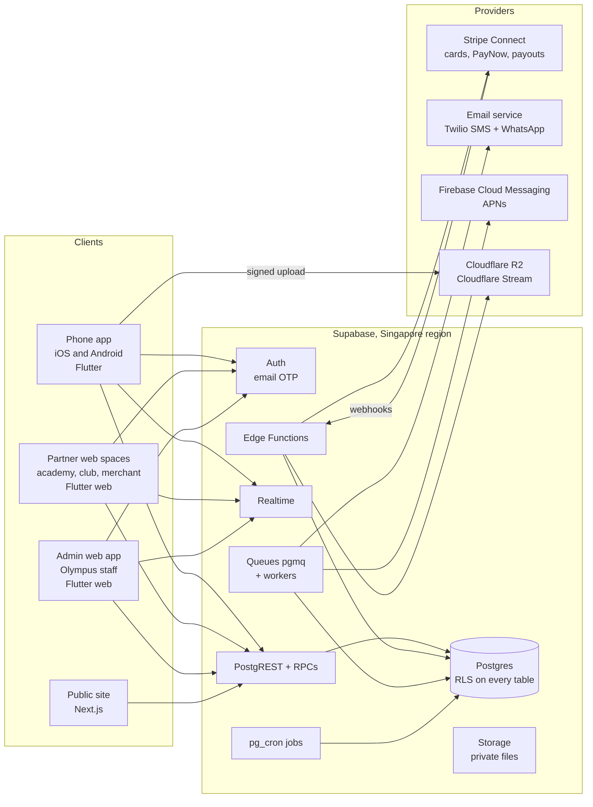
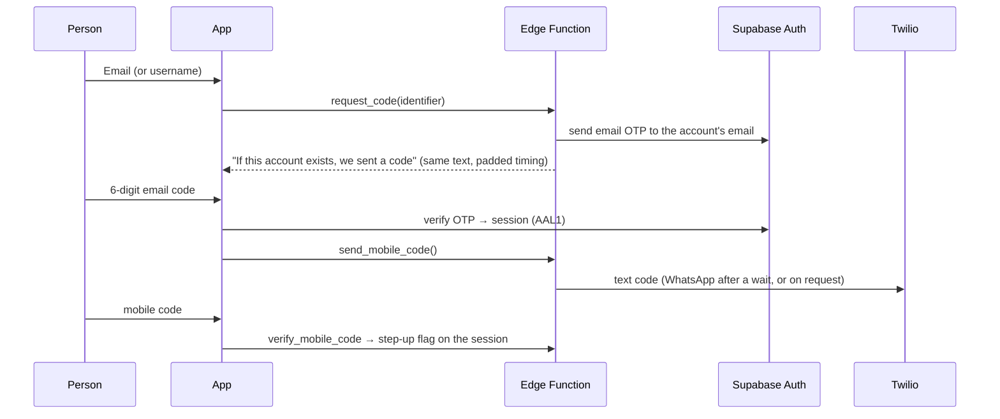
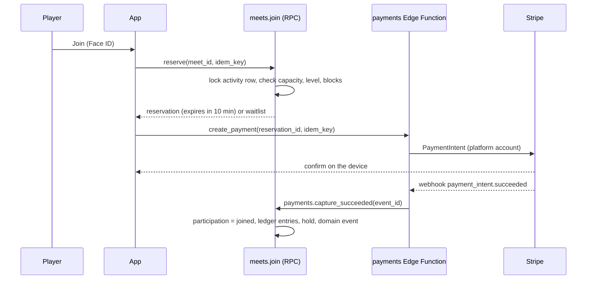
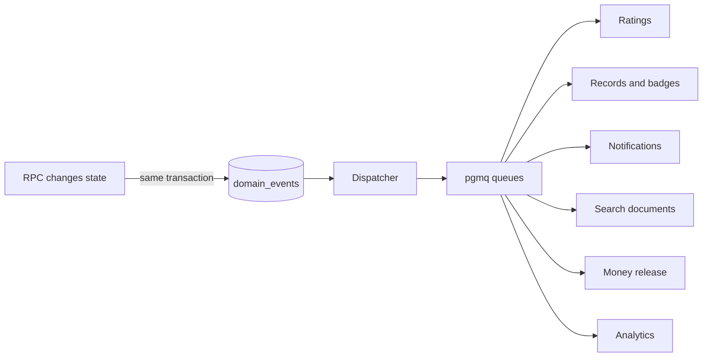

# OlympusGO technical architecture

Version 1.0 · 10 Oct 2026 · for the development team

This is the technical blueprint for building OlympusGO. It turns the product requirements (PRD), the approved architecture change requests (ACR-001 to ACR-018, approved 24 Sep 2026) and the design canvas into one plan developers can estimate and build from.

**Status.** Nothing is built yet. The design prototype (canvas Version 134, about 300 screens) shows every flow. Items marked **[Assumed]** are suggestions the team confirms in week 1. Items marked **[Open]** need a decision from the owner or a lawyer before that part is built.

**Companion documents**

| Document | What it holds |
| --- | --- |
| OlympusGO PRD | Every requirement with an ID (ACC-1, MET-6, PAY-2 …), its release stage and its screens |
| Club Screen Mockup (design canvas) | The clickable prototype; each screen is named in the PRD |
| OlympusGO v1.3 Architecture Change Requests | The 18 approved ACRs this document builds on |
| Olympus technical checklist | Who does what before launch: decisions, accounts, legal, store, testing |
| OlympusGO checklist | Design work that is done and not done |

When this document and an ACR disagree, the ACR wins until a new ACR changes it.

---

## Contents

1. Principles
2. System overview
3. Technology stack
4. Repository layout
5. Client apps
6. Backend: where code runs
7. Data model by domain
8. Security standard (Supabase)
9. Identity, sign-in and age
10. Organisations, roles and permissions
11. Activities, attendance and matches
12. Ratings, records and leaderboards
13. Money: payments, holds, refunds, Wallet, payouts and points
14. Domain events and the outbox
15. Notifications and messaging
16. Search and Discover
17. Media, video and live
18. Safety, moderation and the admin web app
19. Privacy and data classification
20. Camera features (phase 2)
21. Environments, CI/CD and releases
22. Testing
23. Observability and operations
24. Performance, scale and cost
25. Build order by release stage
26. Open decisions
27. Glossary

---

## 1. Principles

1. **The database enforces the rules.** Row-level security, constraints and transactional RPCs protect data and invariants. The app is never the only guard.
2. **One source of truth.** The phone app, the partner web spaces and the admin web app are all clients of one database. A change saved on the web shows in the app.
3. **Money is a ledger.** Every payment, hold, fee, refund and payout is an append-only entry. Balances are computed, never typed in.
4. **Private and public data live apart.** Private identity (birth date, phone, consents) is in separate tables that public queries never join (ACR-002).
5. **Youth safety by default.** Age status exists from the first release, and every public surface checks it (ACR-002, ACR-013, ACR-015).
6. **Facts travel as events.** State changes write a domain event in the same transaction; other domains react from a queue (ACR-006).
7. **Server decides trust.** Ratings, records and payouts accept only server-confirmed results. The camera proposes, people or rules confirm (ACR-008, ACR-011).
8. **Small, replaceable parts.** Providers (payments, SMS, video) sit behind interfaces so one can be swapped without touching domains.

---

## 2. System overview



Three addresses **[Assumed]**:

| Address | Serves |
| --- | --- |
| `olympus.sg` | Public site (search-engine readable) and deep links into the app |
| `partners.olympus.sg` | Academy web space, club tools, merchant web space |
| `admin.olympus.sg` | Admin web app for Olympus staff only; can move to its own host later |

---

## 3. Technology stack

| Layer | Choice | Status | Notes |
| --- | --- | --- | --- |
| Phone app | Flutter (Dart), iOS and Android | [Assumed], in ACRs | One codebase. GoRouter for navigation |
| State management | Riverpod | [Open] code generation or manual providers (ACR-017 open decision) | Decide once in week 1 and record it |
| Partner and admin web | Flutter web | [Assumed] | Shares models and design tokens with the app |
| Public site | Next.js | [Assumed] | Static and server-rendered pages for search engines |
| Database and auth | Supabase: Postgres, Auth, PostgREST, Realtime, Storage, Edge Functions, Queues (pgmq), pg_cron | In ACRs | Singapore region. Pro plan before real users |
| Search | Postgres full-text search + pg_trgm | In ACR-012 | Replaceable later behind the same RPC |
| Payments | Stripe Connect | [Assumed] | Cards and PayNow; manual payouts to hold money until attendance. Model needs legal review (section 13) |
| Email | A transactional email service from the company domain | [Assumed] | SPF, DKIM and DMARC set up |
| SMS and WhatsApp | Twilio | [Assumed] | Singapore sender ID registered; WhatsApp templates approved by Meta |
| Push | Firebase Cloud Messaging (APNs for iOS) | [Assumed] | |
| Photos and files | Cloudflare R2 | [Assumed] | No download fees; private bucket for ID documents |
| Video and live | Cloudflare Stream | [Assumed] | Shop videos and live selling |
| Error tracking | Sentry or similar | [Assumed] | App, web and Edge Functions |
| Feature flags | A flags table plus country config | [Assumed] | Per-country and per-phase switches |

---

## 4. Repository layout

One monorepo **[Assumed]**:

```
olympusgo/
├── apps/
│   ├── mobile/            Flutter phone app
│   ├── partner_web/       Flutter web: academy, club, merchant spaces
│   ├── admin_web/         Flutter web: Olympus staff
│   └── site/              Next.js public site
├── packages/
│   ├── core/              Dart: models (freezed), API client, money and time helpers
│   ├── ui/                Dart: design tokens, components, icons
│   └── l10n/              Translations, currency and date formats
├── supabase/
│   ├── migrations/        SQL migrations, one per change, classified columns
│   ├── functions/         Edge Functions (TypeScript, Deno)
│   ├── workers/           Queue consumers
│   ├── policies/          Permission matrices per org type (versioned config)
│   ├── tests/             pgTAP: RLS, RPC, race and idempotency tests
│   └── seed/              Local and test data (no real people)
├── docs/
│   ├── adr/               ACRs and later decision records
│   └── runbooks/          One per scheduled job and incident type
└── .github/workflows/     CI pipelines
```

**Rules.** Feature-first folders inside each app (`features/meets/`, `features/wallet/`). No secrets in the repo. Every migration tags its new columns with a sensitivity level (section 19).

---

## 5. Client apps

### 5.1 Phone app structure

- **Navigation.** Bottom bar with five tabs: Home, Discover, Scan, Inbox, Profile. Categories (Play, Group, Academy, Game, Venue, Shop) open from Home. Back always returns to the previous screen (the prototype could not do this).
- **Feature modules.** One folder per domain, each with `data/` (repository calling RPCs), `application/` (Riverpod providers), `presentation/` (screens and widgets).
- **Shared payment sheet.** One widget used by every paid flow (PAY-1): review, then Face ID or fingerprint, then receipt.
- **States.** Every screen handles loading, empty, offline, full and failed payment with the shared state components (NFR-11).
- **Deep links.** `olympus.sg/m/<token>`, `/c/<token>`, `/t/<token>` open Meets, clubs and tickets. Tokens are opaque and revocable (ACR-015).
- **Biometrics.** `local_auth` returns pass or fail only; nothing biometric leaves the phone.
- **Offline.** Read caches for schedule, tickets and the player's QR code, so check-in works with poor signal. Writes need a connection.

### 5.2 Partner and admin web

- Same `core` and `ui` packages as the app.
- Desktop layouts; they must still work on a tablet.
- The admin web app signs in staff only, with two-step verification, and logs every action (section 18).

### 5.3 Design tokens

Colours, type and spacing come from the canvas theme board (light Tangerine, dark Electric lime). Dark screens ship later, but tokens for both exist from the start. Minimums: 44 px tap targets, 12 px text, 4.5:1 contrast (NFR-10).

---

## 6. Backend: where code runs

ACR-005 fixes four server runtimes. Putting work in the wrong one is a review failure.

| Runtime | Use for | Examples | Never for |
| --- | --- | --- | --- |
| Database RPC (Postgres function) | Rules that must hold in one transaction | Join or leave a Meet, waitlist promotion, submit or confirm a score, ledger entries, role changes | Calls to outside services, secrets |
| Edge Function | Secrets and outside systems | Username sign-in, Stripe calls and webhooks, email and SMS sending, upload URLs | Multi-row rules needing a transaction |
| Queue worker (pgmq) | Retryable or heavy work | Notification fan-out, rating recalculation, search updates, video processing, event consumers | Anything the user must see succeed at once |
| Scheduled job (pg_cron) | Time-driven work | Release held money, waitlist offer expiry, score auto-escalation, payouts run, data deletion | User-triggered actions |

**Conventions**

- Every consequential RPC takes an `idempotency_key`, enforced by a unique constraint. A retried request never books, refunds or pays twice.
- RPC names are verbs in a domain schema: `meets.join(meet_id, idempotency_key)`, `payments.refund(...)`.
- Edge Functions that write data call a narrowly granted RPC, not the service role, wherever possible.
- The service-role key exists only in server secret stores. Developer machines and AI agents use development projects only (ACR-017).
- Every scheduled job has an owner, a runbook in `docs/runbooks/` and an alert.

**Scheduled jobs needed for launch**

| Job | When | What it does |
| --- | --- | --- |
| `release_held_funds` | Every 15 minutes | Releases money for activities whose attendance is saved, or that ended 24 hours ago |
| `waitlist_offers` | Every minute | Expires unanswered waitlist offers and offers the spot to the next person |
| `score_escalation` | Hourly | Sends scores unconfirmed after 24 hours to the organizer |
| `meet_minimum_check` | Hourly | 24 hours before start, asks the organizer to cancel or play if under the minimum |
| `attendance_close` | Daily, 23:59 local | Closes attendance for the day's Meets |
| `payout_run` | Weekly (Monday) | Prepares payouts for staff approval; a second staff member approves |
| `leaderboard_snapshots` | Daily and month end | Builds Local and club boards; resets monthly and yearly |
| `retention_delete` | Daily | Erases accounts 30 days after deletion; removes data past its keep period |
| `makeup_credit_expiry` | Daily | Expires academy make-up credits after 30 days |
| `class_change_sms_fallback` | Every 15 minutes | Sends SMS to parents who have not read a class change after 2 hours |
| `ledger_reconcile` | Daily | Compares Stripe balance transactions with the ledger and alerts on any difference |

---

## 7. Data model by domain

Schemas group tables by domain. Only `public`-facing schemas are exposed through the API; authorisation helpers live in a `private` schema (ACR-004). Tables below are the core of each domain, not every column.

### 7.1 Identity and safety (Foundation)

| Table | Purpose | Key columns |
| --- | --- | --- |
| `auth.users` | Supabase Auth; holds the email | managed by Supabase |
| `profiles` | Public player profile | `user_id`, `username`, `display_name`, `avatar_path`, `home_area`, `audience_class` (adult, minor_restricted, minor_guardian_managed; server-written), `moderation_status` (active, limited, suspended; server-written) |
| `user_private` | Private identity, never joined into public queries | `user_id`, `date_of_birth` (write-once by RPC), `mobile_e164`, `mobile_verified_at`, `country_code`, `verification_method` |
| `consents` | Purpose-based consents with history | `user_id`, `purpose`, `granted`, `granted_at`, `withdrawn_at`, `version` |
| `guardian_links` | Identity-level parent and child links | `guardian_id`, `child_id`, `scopes[]`, `status`, `verified_at` |
| `child_profiles` | Under-13 profiles inside a parent's account | `id`, `guardian_id`, `display_name`, `birth_year` |
| `user_blocks` | Blocks, checked in every read path | `blocker_id`, `blocked_id` |
| `abuse_reports` | Reports from users | `reporter_id`, `target_type`, `target_id`, `reason`, `status` |
| `moderation_cases`, `moderation_decisions` | Staff decisions, kept 3 years | `case_id`, `decided_by`, `rule`, `outcome`, `second_approver_id` |
| `account_deletions` | Deletion requests with the 30-day undo | `user_id`, `requested_at`, `erase_after` |
| `recovery_requests` | Getting back in without email and mobile | `user_id`, `evidence_path` (private), `status`, `approved_at`, `effective_after` (7-day wait) |

### 7.2 Organisations (Beta onward)

One framework for every organisation type (ACR-007).

| Table | Purpose | Key columns |
| --- | --- | --- |
| `organizations` | Club, academy, tournament organiser, brand, venue operator, team **[Assumed: team as an org type; confirm by ACR]** | `id`, `org_type`, `name`, `visibility` (public, private, hidden), `status`, `verification_state`, `home_venue_id` |
| `organization_members` | Membership | `org_id`, `user_id`, `role_id`, `status`, `valid_from`, `valid_to` |
| `org_roles` | Custom roles per organisation | `org_id`, `name`, `colour`, `level` (label, member, organizer, admin, owner), `position` |
| `org_role_permissions` | Permissions per role | `role_id`, `permission` |
| `club_ext`, `academy_ext`, `team_ext`, `venue_ext` | Type-specific rules | e.g. `team_ext.sport_id`, `team_ext.linked_club_ids[]` |
| `org_sports` | Up to 3 sports per club (5 shown on page) | `org_id`, `sport_id`, `is_primary`, `level_min`, `level_max` |
| `join_requests`, `org_bans`, `org_invites` | Membership flows | invite tokens expire after 7 days |
| `audit_events` | Append-only change log, 90-day view in clubs | `org_id`, `actor_id`, `action`, `before`, `after` |

### 7.3 Activities and attendance (Foundation and Beta)

| Table | Purpose | Key columns |
| --- | --- | --- |
| `activities` | Meets, events and tournaments share one header | `id`, `kind` (meet, event, tournament), `org_id`, `sport_id`, `title`, `starts_at`, `ends_at` (UTC), `venue_id`, `visibility`, `status`, `series_id` |
| `activity_series` | Repeating Meets | `rule` (weekly, fortnightly, days), `count` |
| `meet_settings` | Meet-only rules | `game_type`, `min_players`, `max_players`, `level_min`, `level_max`, `ranked`, `fee_mode` (paid, free_organizer_pays, free_players_pay), `price_minor`, `currency` |
| `participations` | Who is in | `activity_id`, `user_id`, `status` (joined, waitlisted, offered, left, removed), `paid_order_id`, `guest_of` |
| `attendance` | Present or absent | `activity_id`, `user_id`, `status`, `method` (geofence, organizer, qr), `recorded_by`, `recorded_at` |
| `event_ticket_types`, `tickets` | Event tickets with QR | `ticket_code` (opaque), `holder_id`, `status` |
| `tournament_events`, `entries`, `draws` | Tournament structure | `event_type`, `tier`, `seed`, `group`, `round` |

**Rules held in RPCs.** Capacity and waitlist position are checked inside `meets.join` with a row lock on the activity. They never rely on a count read by the app.

### 7.4 Matches and records (Beta and Launch)

From ACR-008 and ACR-009.

| Table | Purpose |
| --- | --- |
| `matches` | Sport, ruleset version, `context_type` (casual, activity, ranked, tournament, academy), `context_id`, status |
| `match_sides`, `match_participants` | Who played on which side |
| `match_result_submissions` | Scores entered by players, umpires or the camera |
| `match_results` | Confirmed results; immutable; corrections add a new row with `supersedes_id` |
| `match_disputes` | Disputes, decided by the organizer after 24 hours |
| `efforts`, `effort_measurements` | Non head-to-head sport (runs, drills, timed sims) |
| `sports_records`, `sports_record_metrics` | Journey and performance records fed by events |
| `metric_definitions` | Units, direction, plausibility bounds, sensitivity, minimum trust per use (ACR-010) |
| `ratings` | Current rating per user and sport; `provisional` until about 5 confirmed matches |
| `ranking_events` | Append-only rating changes |
| `tournament_points` | Ranking points by placing and tier, per season |
| `leaderboard_snapshots` | Local, Tournament and club boards per period |
| `achievement_definitions`, `user_achievements` | Badges, awarded idempotently |

### 7.5 Money (Launch)

See section 13. Core tables: `orders`, `order_lines`, `payment_attempts`, `ledger_accounts`, `ledger_entries` (append-only), `holds`, `refunds`, `payout_batches`, `payouts`, `points_entries` (append-only), `stripe_events` (webhook log with unique event id).

### 7.6 Academy (Launch)

`academy_levels`, `skills`, `classes`, `class_sessions`, `enrolments`, `trial_bookings`, `skill_marks`, `curriculum_weeks`, `lesson_plans`, `drills`, `class_changes` (with read receipts), `makeup_credits`, `invoices`, `coach_licences` (NROC, verified), `filming_consents` (phase 2).

### 7.7 Commerce (Launch)

`shops`, `products`, `product_variants`, `inventory`, `carts`, `shop_orders`, `shipments`, `returns`, `reviews`, `videos` (Cloudflare Stream ids), `live_sessions`, `product_tags_in_video`, `affiliate_attributions`, `services`, `service_slots`, `service_bookings`.

### 7.8 Venues (Foundation and Launch)

`venues` (owned by a Places module, admin-curated; ACR-012), `courts`, `court_prices`, `court_bookings` (with door codes), and later venue operator access.

### 7.9 Messaging, notifications, campaigns

`conversations` (direct, club, team, class, shop, support), `conversation_members`, `messages`, `message_reports`; `notification_preferences` (per kind, per channel), `notification_outbox`, `push_tokens`; `campaigns`, `campaign_progress`, `challenges`, `challenge_attempts`.

### 7.10 Platform

`domain_events` (outbox), `search_documents`, `feature_flags`, `country_config` (currency, emergency number, age thresholds, regulator), `field_registry` (sensitivity of every column), `idempotency_keys`.

**Data rules everywhere**

- Money is stored as integer minor units (cents) with an ISO currency: `amount_minor bigint`, `currency char(3)`. Never decimals.
- Times are stored in UTC (`timestamptz`) and shown in the activity's local time zone. Singapore and Malaysia are UTC+8; New Zealand is UTC+12 or UTC+13 in daylight saving.
- Primary keys are UUIDs. Public links use opaque, revocable tokens, never row ids (ACR-015).
- Soft-deleted rows are excluded by RLS, and erased by the retention job when their keep period ends.

---

## 8. Security standard (Supabase)

ACR-004 is mandatory. No migration merges unless CI proves all of this:

- RLS is on for every table in exposed schemas; a CI meta-test fails if one is missing.
- Table-level `UPDATE` is revoked from `authenticated`; updates are granted only on named safe columns.
- Protected fields (status, role, trust level, birth date, audience class, moderation status) have no client write path. Status changes go through RPCs that check an allowed-transition table.
- Authorisation helpers live in `private` as `SECURITY DEFINER` with `SET search_path = ''` and fully qualified names.
- `REVOKE EXECUTE ... FROM PUBLIC, anon` by default; each RPC gets explicit grants and a test.
- Client-readable views use `security_invoker = true`, or are replaced by RPCs.
- Policies never read `user_metadata`. Roles come from membership tables, or from `app_metadata` set by the server.
- Policies call `(select auth.uid())` so it is evaluated once per statement.
- Append-only tables (`audit_events`, `ledger_entries`, `ranking_events`, `points_entries`, `domain_events`) have no `UPDATE` or `DELETE` grants, plus a trigger that rejects changes.
- Policies check `moderation_status`, so a suspension takes effect at once, not at token expiry.
- Storage policies check bucket and path prefix against membership. ID documents and recovery evidence sit in a private bucket with short-lived signed URLs.
- Every read path that shows one user to another calls `private.is_blocked_between(a, b)`. A blocked user sees "not found", never "forbidden" (ACR-013).

**Also required**

- Rate limits on every public endpoint and on code sending (per target account, per IP, per device), with a CAPTCHA after thresholds.
- Dependency scanning in CI and a monthly update habit.
- Secrets in the platform secret stores, separate for development, test and live.
- An outside penetration test before the beta gate.

---

## 9. Identity, sign-in and age

### 9.1 Sign-up and log-in

Passwordless. Email is the identifier; the mobile number is a required second check (ACC-1 to ACC-7, ACR-014).



- Codes are 6 digits, valid 10 minutes, single-use; a new code cancels the old one.
- Resend allowed after 30 seconds. After 5 wrong attempts, a 15-minute lockout **[Assumed rule, confirm]**.
- Send limits apply per target account no matter who asks, so a public username cannot flood someone's inbox.
- The email is never returned, shown, partly masked or logged.
- On a phone used before, Face ID or fingerprint unlocks a stored refresh token instead of the mobile code.
- Phone is a second factor and a recovery channel, not a login identifier (ACR-014).
- **Duplicate mobile.** If the number is on another account, offer "sign in to that account" or a claim. A claim verifies the number by code, removes it from the old account, and notifies that account by email (ACC-4).
- **Changing email or mobile** needs Face ID and a code to the other channel, and alerts the old contact (ACC-9).
- **Account Centre** requires a fresh biometric or passcode check (a short-lived step-up flag on the session).

### 9.2 Age paths

Date of birth is written once to `user_private` by an RPC. The server sets `profiles.audience_class`.

| Age | Path | `audience_class` |
| --- | --- | --- |
| 18+ | Own account | `adult` |
| 13–17 | Own account, inactive until a parent approves through a `guardian_links` row | `minor_restricted` |
| Under 13 | A `child_profiles` row inside the parent's account; no login of its own | `minor_guardian_managed` |

- Age thresholds come from `country_config`, never from code.
- **[Open] Conflict to resolve.** ACR-002 says to block self-registration below the threshold age until the guardian model is built, which falls in a later phase. The design and PRD show the 13–17 and under-13 paths in the first release. Either build `guardian_links` in Foundation, or block under-18 sign-up until it ships. Decide before sprint 1.
- Effects of being a minor are enforced in RLS and RPCs, not in the app: no Public session visibility, no private messages from adults, no paid gifting, no public share without guardian approval, excluded from public Discover and leaderboards unless a guardian opts in.

### 9.3 Deletion and recovery

- **Deletion:** the profile is hidden at once, with a 30-day undo, then erased by `retention_delete`. Match results are re-pointed to a "Former player" placeholder. Receipts and the ledger are kept as the law requires. The Wallet balance is paid out first; upcoming bookings are refunded.
- **Recovery** (both email and mobile lost): evidence goes to a private bucket for staff review within 3 working days. Then a 7-day wait, with notices to the old email and mobile. Then the new contacts replace the old ones and every session is revoked.

---

## 10. Organisations, roles and permissions

- One helper family: `private.has_org_permission(org_id, permission)` and `private.has_org_role(org_id, levels[])`, tested once and used everywhere.
- **Permissions** (clubs): `create_meets`, `make_meets_public`, `manage_checkins`, `run_tournaments`, `create_events`, `approve_join_requests`, `manage_members`, `manage_roles`, `edit_club_info`, `view_audit_log`, `manage_fees_payouts`.
- The **Owner** role cannot be edited or deleted. The last owner cannot leave. Only an owner can grant money permissions. Ownership transfer needs the current owner plus a recent step-up check.
- Permission matrices per `org_type` are versioned files in `supabase/policies/` and have tests. Academy roles (Head Coach, Coach, Assistant, Admin, Student, Parent/Guardian) are a separate matrix from club roles.
- **Visibility.** Public clubs appear in search and anyone can see the page. Private clubs appear in search, but outsiders see only the floating card. Hidden clubs never appear in search.
- **Teams** pick players only from linked clubs of the same sport. Under-18 teams need parent confirmation for each invite, and staff are in every team chat.

---

## 11. Activities, attendance and matches

### 11.1 Joining a paid Meet



- The spot is held for 10 minutes **[Assumed]** while payment completes; expired reservations free the spot.
- The webhook, not the app, confirms payment. Webhook handling is idempotent on the Stripe event id (`stripe_events` unique key).
- Free Meets skip payment. When the organizer pays the S$2 per player, the fee is charged to her saved method when the player joins.

### 11.2 Waitlist

- Joining a full Meet adds a `waitlisted` participation; no charge.
- When a spot opens, the next person gets an `offered` state for 30 minutes **[Assumed, from the technical checklist]**. More than 24 hours before the start: offer with expiry. Inside 24 hours: auto-join and charge **[Open: ACR open decision]**.

### 11.3 Attendance and check-in

- Attendance opens 30 minutes before the start and closes at 23:59 local time that day.
- **Automatic:** when the player's phone enters the venue geofence during that window, the app calls `attendance.check_in` with a signed location assertion. Location is used once and not stored as history (ACR-015).
- **Fallback:** the organizer taps Check in; QR scan at the venue also works.
- Saving attendance emits `attendance.recorded`, which releases held money (section 13) and creates Journey records and points.

### 11.4 Scores

- `matches.submit_result` → the other side confirms with `matches.confirm_result`, or an umpire's entry is final (tournaments).
- Unconfirmed after 24 hours, or disputed: the organizer decides.
- Confirmation emits `match.result_confirmed`; a correction emits `match.result_corrected` with `supersedes_id`.

### 11.5 Tournaments

- Seeding by main rating; round-robin groups then knockout; court assignment by a scheduler worker; court call notifications.
- Team entries enforce lineup rules in `teams.publish_lineup`; lineups lock 24 hours before each tie.
- Swiss format, multi-venue and live streaming come later.

---

## 12. Ratings, records and leaderboards

- **Rating engine.** Glicko-2 **[Assumed; Elo is the alternative named in the spec]**. A queue worker consumes `match.result_confirmed`, updates `ratings`, writes `ranking_events`, and emits `ranking.changed`. Only ranked contexts move ratings. Tournament matches are weighted higher than Meets.
- **Provisional:** the self-chosen starting level is provisional until about 5 confirmed matches. Players can choose AD at most; PRO needs verification.
- **Levels** are bands on the rating: LB 1.0, MB 2.0, HB 3.0, LI 4.0, MI 5.0, HI 6.0, AD 7.0, PRO 8.0 and above.
- **Anti-gaming.** Diminishing returns against the same opponent. Flags for sudden drops (sandbagging), sudden jumps and closed groups that only play each other. Graded entry caps by rating.
- **Leaderboards** are snapshots, not live queries:
  - Local: by declared area, monthly, players with at least 4 confirmed matches that month **[Assumed rule]**, opt-in for public listing (ACR-015).
  - Tournament: ranking points by placing and tier, yearly; only verified organisers with 16 or more entries count.
  - Club: monthly, by sport, with an optional team cut-off.
- Rank earns badges only, never points or money.
- **Records** (ACR-009): Journey records come from attendance, and performance records from matches. Personal bests are derived and can be recomputed.

---

## 13. Money: payments, holds, refunds, Wallet, payouts and points

The highest-risk area. Every rule here has automated tests before launch.

### 13.1 Model

**[Assumed, needs legal review]** Stripe Connect. The player pays the Olympus platform account. Funds are attributed to the organizer's connected account but held until attendance, using a manual payout schedule. Stripe has no escrow product; a hold can last up to 90 days in Singapore, Malaysia and New Zealand.

**[Open, legal]** ACR-018 says phases before payments must not assume Olympus is merchant of record. The 9 Oct design has Olympus holding customer money until attendance and keeping a refund Wallet. A lawyer must confirm this against MAS payment-services licensing before any payment code is written.

### 13.2 Ledger

Double-entry, append-only. Every balance is a sum of entries.

| Account | Holds |
| --- | --- |
| `customer_card_clearing` | Money in flight from card payments |
| `held:<activity_id>` | Price held until attendance |
| `platform_fees` | Olympus's 10% (S$2 minimum) |
| `organizer:<org_id or user_id>` | Released earnings |
| `wallet:<user_id>` | Refunds and rewards (no top-up at launch) |
| `card_fee_recovery:<organizer>` | Card fees on organizer cancellations |
| `payouts_pending` | Approved payouts awaiting Stripe |

Example, a S$6 paid Meet (S$8 charged):

| Step | Debit | Credit | Amount |
| --- | --- | --- | --- |
| Payment succeeds | customer_card_clearing | held:meet | S$6.00 |
| | customer_card_clearing | platform_fees | S$2.00 |
| Attendance saved | held:meet | organizer:hannah | S$6.00 |
| Weekly payout approved | organizer:hannah | payouts_pending | S$6.00 |

### 13.3 Fees

10% of the price, S$2 minimum, added on top. The organizer keeps the full price. Fee rules live in `country_config` and a `fee_rules` table, not in code.

### 13.4 Refunds

| Who cancels | Rule | Destination |
| --- | --- | --- |
| Organizer, venue or shop | Everything back, fee included | Wallet (instant) or card (3–5 working days). Card fees for the refunds are debited from the organizer |
| Player, in time | Wallet: everything. Card: price without the fee | Player's choice |
| Player, late or no-show | Nothing | — |

"In time": Meets before the start; paid tickets until 24 hours before; tournaments until registration closes; courts and shop orders by their own rules. A member who is removed or banned gets a full refund for upcoming paid Meets.

### 13.5 Wallet and payouts

- **Wallet** is a ledger account. It is spendable in the app and can be withdrawn to a bank free of charge. Top-up is parked (the screen exists but is unlinked).
- **Payouts** run weekly. Staff approve each batch, and a second staff member approves batches over a threshold **[Open: threshold]**. Instant PayNow costs S$0.50 **[Assumed rule]**.
- People who get paid (organizers, sellers, coaches, creators) complete Stripe's own identity and business onboarding.
- **Disputes:** card disputes arrive by webhook and open an admin case with the evidence.
- **Reconciliation:** a daily job compares Stripe balance transactions with the ledger and alerts on any difference.

### 13.6 Points

- Earned at twice the platform fee paid (a S$2 fee earns 4 points), only after the payer is marked Present. They go to whoever paid the fee.
- 1 point is S$1 off at partner shops, capped per item at Olympus's commission on it.
- Weekly earning cap, 12-month expiry, a minimum account age before redeeming, and no cash-out or transfer.
- `points_entries` is a separate ledger from money.

### 13.7 Currencies

SGD at launch. MYR and NZD before those countries open, each with its own Stripe set-up; money stays within its region. Local payment methods are checked per country.

---

## 14. Domain events and the outbox

ACR-006.



- Each event has `event_id`, `type`, `schema_version`, `aggregate_type`, `aggregate_id`, `aggregate_version`, `occurred_at` and a minimal payload with opaque ids only.
- Delivery is at-least-once. Consumers are idempotent on `(event_id, consumer)` and process events of one aggregate in version order.
- Failures go to a dead-letter queue with an alert, and consumers can be replayed.
- Capacity, waitlist position and ledger balances are enforced in RPCs, never via events.
- Realtime broadcasts UI updates derived from events, but it is never the event bus.

**Event catalogue (initial)**

`activity.participant_joined`, `activity.participant_left`, `activity.cancelled`, `activity.completed`, `attendance.recorded`, `payment.succeeded`, `payment.refunded`, `funds.released`, `payout.paid`, `match.result_confirmed`, `match.result_corrected`, `record.created`, `record.personal_best`, `ranking.changed`, `achievement.unlocked`, `user.blocked`, `user.suspended`, `consent.withdrawn`, `class.changed`, `org.member_removed`.

---

## 15. Notifications and messaging

- **Pipeline:** event → notification worker → reads the recipient's `notification_preferences` → writes `notification_outbox` → channel sender (push, email, SMS, WhatsApp, Telegram).
- **Preferences:** per message kind and per channel. SMS is only allowed for urgent kinds (Meet changed, match called, class changed). Sign-in codes and receipts are always on.
- **Quiet hours** run 22:00–07:00 local; only Meet changes break through.
- **Cost control:** Olympus pays for every SMS and WhatsApp message. Set a monthly budget alert and prefer push and email.
- **Chat:** `conversations` of type direct, club, team, class, shop or support. Realtime delivers messages. Under-18 rules are enforced in RLS: adults cannot open direct conversations with minors, and staff are members of every team and class conversation. Organizers can delete a message for everyone, and every message can be reported.

---

## 16. Search and Discover

ACR-012.

- `search_documents` is written only by event consumers. Player documents hold public (P0) fields only, each gated by the player's visibility settings.
- One query path: the `search(query, filters, cursor)` RPC. It applies blocks both ways, moderation status, audience class (minors excluded), private-organisation membership and visibility.
- Player search: exact username by default. Appearing in browse by area, sport or level is opt-in. Players need a minimum query length, there is no empty-query browse of players, results are paged with a cursor, and requests are rate-limited.
- No distances to players are shown; only declared areas.
- Venues are owned by a Places module (admin-curated, user suggestions through moderation).

---

## 17. Media, video and live

- **Uploads:** the app asks an Edge Function for a signed URL, then uploads straight to R2 or Stream. The database stores only the object key.
- **Photos:** size limits, server-side resizing, EXIF location stripped.
- **Safety:** uploads are hash-matched against known child-abuse imagery before display, and matches are blocked and reported as the law requires. Live streams have in-stream reporting and a staff kill switch.
- **Private files:** ID documents, recovery evidence and coach licences sit in a private bucket and are deleted after the check.
- **Shop videos:** a product tag is a timestamped link to a product. A paid partnership flag is required on sponsored posts.
- **Under-18 feed:** following only, no autoplay, and it ends.

---

## 18. Safety, moderation and the admin web app

- Admin web app screens (canvas: AdminHome, AdminReports, AdminCase, AdminLegal, AdminLog, AdminRefunds, AdminPayouts, AdminVerify, AdminCampaigns).
- **Staff sign-in:** separate staff accounts with two-step verification, roles (trust and safety, payments, partnerships, viewer) and full action logging. Not designed yet (ADM-5).
- **Two-person rule:** bans and payouts above a threshold need a second approver.
- **Service levels:** reports answered within 24 hours. New Zealand complaints give the poster 48 hours to reply.
- `moderation_decisions` are kept 3 years: who decided, when, the rule, and who was told.
- Users get removal notices with a review request, and can follow their reports (My reports).

---

## 19. Privacy and data classification

ACR-003. Every column is tagged in `field_registry`, and CI checks that search documents, event payloads, share payloads and report RPCs select only permitted levels.

| Level | Meaning | Examples |
| --- | --- | --- |
| P0 Public | Safe to show, subject to user settings | Username, display name, avatar, public rank |
| P1 Account | Seen by people you interact with | Participation, memberships |
| P2 Private | Owner and narrow server paths | Email, phone, precise area |
| P3 Sensitive | Explicit consent beyond the owner | Date of birth, private progress notes, health data |
| P4 Restricted | No public or third-party flow | Guardian links, raw camera video, ID documents |

- Anything about a minor goes up at least one level, and a minor's username is not public.
- Analytics are pseudonymous and gated by consent.
- **Retention:** each data type has a keep period (set with the lawyer), enforced by `retention_delete`.
- **Breach response:** Singapore requires notifying the PDPC within 3 days of finding a notifiable breach. Malaysia and New Zealand have their own rules. Keep a runbook.

---

## 20. Camera features (phase 2)

Not at launch. Built only after the badminton feasibility test passes (ACR-011).

- The server issues a session with a nonce. The capture uploads through a signed URL. A worker runs inference, and the camera proposes scores or measurements that people confirm through Match Core.
- On-device inference may only drive live overlays; it is never accepted as a result. There is no facial recognition.
- Raw video is P4 and deleted a fixed period after confirmation unless disputed. Under-18s need parent filming consent. There is no model training on user media without separate consent.
- Sport adapters sit behind a fixed contract, so a vendor can replace in-house models.

---

## 21. Environments, CI/CD and releases

| Environment | Purpose | Data |
| --- | --- | --- |
| Local | Supabase CLI, seeded data | Fake |
| Development | Shared dev project; agents and developers work here | Fake |
| Staging | Release candidates, store reviewers, Stripe test mode | Fake |
| Production | Real members | Real |

**CI on every pull request:**

1. Lint and format (Dart, TypeScript, SQL).
2. Unit tests.
3. Spin up a fresh local database, apply all migrations, and run the Supabase advisor plus the custom SQL lints.
4. pgTAP tests: RLS, grants, RPCs, races, idempotency.
5. Classification check against `field_registry`.
6. Dependency scan.
7. Build the apps.

**CD.** Migrations apply to staging automatically and to production through an approved release. Edge Functions deploy with migrations. Apps ship through TestFlight and Google Play testing tracks, then staged rollout.

**Feature flags** per country and phase: `country.my.enabled`, `country.nz.enabled`, `wallet.topup`, `camera.scoring`, `gifting`.

**Reviews by change type** (ACR-017). Database or RPC changes get security and architecture review. Auth and youth changes get security, privacy and architecture review. New screens get UX, accessibility and privacy review. Money changes get two reviewers.

---

## 22. Testing

| Layer | What | Tool |
| --- | --- | --- |
| Database | RLS for each role (owner, member, outsider, blocked, minor, suspended, anon), grants, transitions | pgTAP |
| Races | 50 parallel joins on the last spot; double webhook delivery; repeated idempotency keys | pgTAP + scripts with parallel connections |
| Money | Every fee, hold, release, refund, card-fee and payout rule; ledger always balances | Unit + integration with Stripe test mode |
| Events | Duplicate delivery, ordering with corrections, dead-letter replay | Worker tests |
| Sign-in | Same response for unknown accounts, timing padding, send throttling, attempt caps | Edge Function tests |
| Apps | Widget and integration tests; the 47 UAT journeys as end-to-end tests | Flutter integration tests |
| Devices | Small and old phones, slow networks, iOS and Android | Device lab or cloud devices |
| Accessibility | Tap targets, contrast, screen readers | Automated checks + manual |
| Load | A popular Meet opening (burst joins), a live stream with many viewers | k6 or similar |
| Security | Outside penetration test before the beta gate | Provider |

---

## 23. Observability and operations

- **Errors:** error tracking in the app, the web apps and Edge Functions, with releases tagged.
- **Monitoring:** uptime checks on the API, auth, webhooks and the public site.
- **Logs:** structured logs with request ids. No personal data beyond opaque ids, and never codes, emails or card details.
- **Dashboards:** payment success rate, refund volume, held funds, queue depth, dead letters, SMS spend, sign-in failures and report backlog.
- **Alerts:** ledger mismatch, dead-letter growth, webhook failures, SMS spend over budget, the report queue over 24 hours.
- **Backups:** daily backups with point-in-time recovery, and a restore drill before launch and every quarter after.
- **On call:** launch week, someone with access to every provider.

---

## 24. Performance, scale and cost

- **Supabase:** the Pro plan covers about 100,000 monthly active users. A bigger compute size is the main step-up beyond that.
- **Video** is the biggest variable cost, so keep it on Stream, not database storage.
- **Paging:** lists load in pages with cursors. The app listens to Realtime changes instead of polling.
- **Indexes:** on every foreign key and filter used by search and lists; review slow queries weekly.
- **Burst capacity:** row locks only on the activity being joined, so popular Meets don't block others.
- **Budget alerts** on every provider: Supabase, Cloudflare, Twilio, Stripe and email.

---

## 25. Build order by release stage

From ACR-001 and ACR-018. Phases 0–7 are fixed; from phase 8 on they can reorder if dependencies are met.

| Phase | Build | Release stage | Exit gate |
| --- | --- | --- | --- |
| 0 | Repo, CI with security lint and pgTAP, design tokens, field registry, event catalogue; camera feasibility spike (parallel); state-management decision | — | All phase 0–1 ACRs approved (done 24 Sep) |
| 1 | Identity split, age status, sign-in (email + mobile), blocking, reporting, moderation status, consents, delete account, admin reports queue and staff sign-in | Foundation | Auth, RLS and enumeration tests pass |
| 2 | Discover projection, curated venues, activities, join and leave, outbox and notifications | Foundation | Discover privacy tests pass |
| 3 | Waitlist, repeating Meets, attendance and check-in, Sports Record core, metric definitions | Core Sports Beta | — |
| 4 | Organisations: clubs, roles, follows | Core Sports Beta | — |
| 5 | Match Core, casual results, share cards | Core Sports Beta | Pen test, moderation runbook staffed, breach plan, PDPA review |
| 6 | Ranked play, rating engine, leaderboards | Public launch | — |
| 7 | Camera v1 (one sport) only if the spike passed; otherwise moved after launch | Public launch or later | Spike approved |
| 8 | Messaging (adults first) | Public launch | — |
| 9 | Payments: ledger, holds, refunds, Wallet, payouts, points (legal decision required first) | Public launch | Legal sign-off on the money flow |
| 10 | Tournaments on Match Core, events and tickets | Public launch | — |
| 11 | Academy and guardians, academy web space; youth features unlock | Public launch | Children's data review |
| 12+ | Shop and sellers, services, creators and campaigns, venue owner side; later wearables, trainer and brand marketplaces | Public launch / later | Legal and privacy sign-off |

**[Open]** The PRD puts Shop, sellers and creators in the public launch. ACR-018 doesn't name them in phases 0–11. Agree where they fit before estimating.

---

## 26. Open decisions

Decide these before the parts that depend on them are built.

| # | Decision | Blocks | Suggested default |
| --- | --- | --- | --- |
| 1 | Payments model and the legal status of holding money and the Wallet | Phase 9 | Stripe Connect with manual payouts, if a lawyer confirms no licence is needed |
| 2 | Under-18 sign-up in Foundation, or block until the guardian model ships | Phase 1 | Build `guardian_links` in phase 1, since the design needs it |
| 3 | Riverpod code generation or manual providers | Phase 0 | Decide in week 1 |
| 4 | Teams as an organisation type | Phase 4 | Yes, with a `team_ext` extension, recorded by a new ACR |
| 5 | Waitlist promotion: offer or auto-join | Phase 3 | Offer with expiry more than 24 hours out; auto-join inside 24 hours |
| 6 | Does Discover need a login? | Phase 2 | Venues and public activities without login; players with login |
| 7 | Minimum sign-up age and guardian verification, per country | Phase 1 | Legal review; thresholds in `country_config` |
| 8 | Hosting region and sub-processor list | Phase 0 | Singapore; publish the list before Foundation |
| 9 | Payout approval threshold for a second approver | Phase 9 | Set with finance |
| 10 | Brand form in the UI: "OlympusGO" or "OLYMPUS GO" | Phase 0 | Confirm the trademarked form |
| 11 | 13 assumed product rules and the 9 Oct assumed rules (PRD, Open decisions) | Each feature | Owner confirms |
| 12 | Where Shop, sellers and creators sit in the phase order | Estimate | Agree before quotes |

---

## 27. Glossary

| Term | Meaning |
| --- | --- |
| Meet | A one-day game hosted by a club |
| Passport | A player's identity: rating, sessions, badges, points |
| Present | Marked as attended; what counts for sessions, points and releasing money |
| Hold | Money paid by a player that Olympus keeps until attendance |
| Release | Moving held money to the organizer's earnings |
| Wallet | A player's refund and reward balance; no top-up at launch |
| Points | Shop discounts earned from fees paid; separate from money |
| Org | Any organisation: club, academy, team, organiser, brand, venue operator |
| RLS | Row-level security in Postgres |
| RPC | A Postgres function called through the API |
| ACR | Architecture change request |
| P0–P4 | Data sensitivity levels (section 19) |
